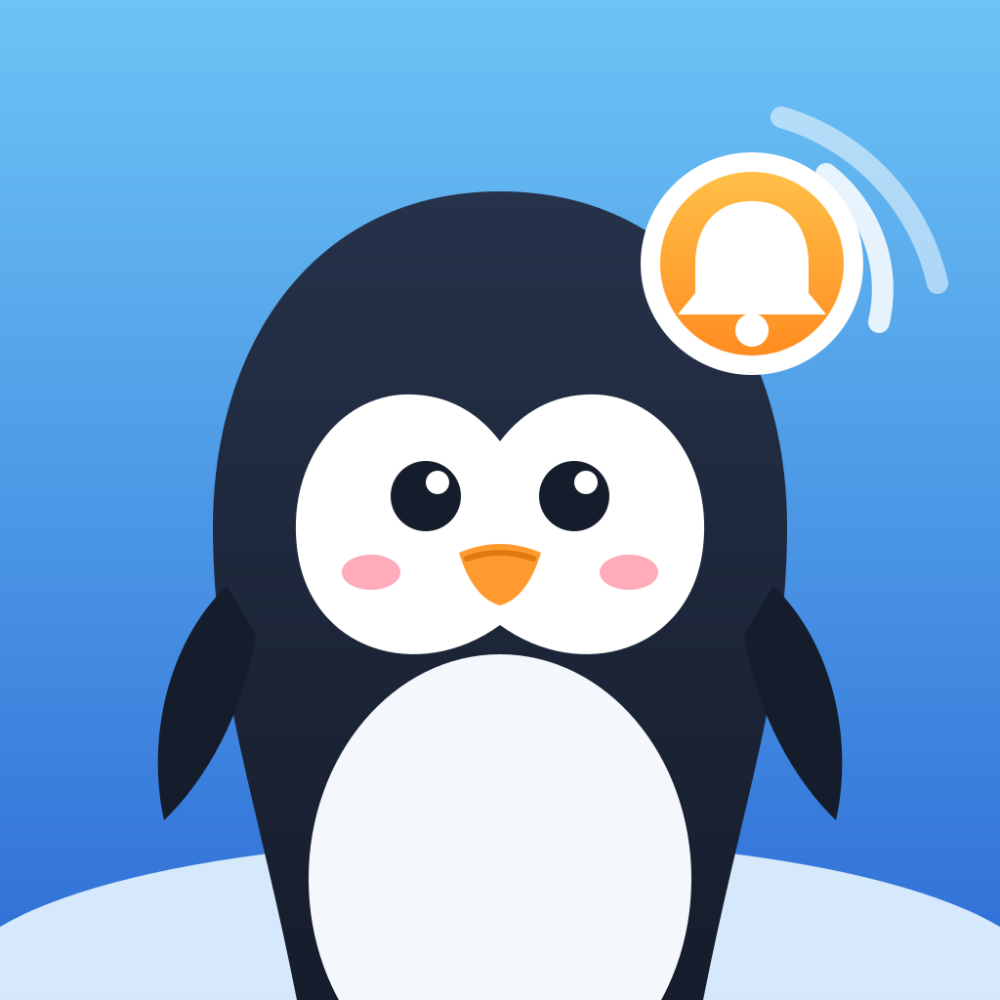

# Pingwin

[](https://github.com/brandonbtm29/Pingwin/actions/workflows/ci.yml)
[](LICENSE)

A friendly Discord bot for a friends' server. Right now it does **opt-in ping roles**:
members tap buttons in `#roles` to choose which pings they get (movie nights,
streams, game days…), so the server can stop using `@everyone` for everything.

- **Swappable personality:** every message comes from a persona file, so you can rename it or change its voice without touching code.
- **Runs on several PCs:** one answers, the others wait on standby and take over if it goes offline.
- **Updates itself** from GitHub.
- **Dashboard** in your browser for settings, status and logs.

## Getting started

**📘 New to Pingwin? Follow the [setup guide](docs/SETUP.md).** It covers everything from creating
the bot in Discord to posting your first menu, plus troubleshooting.

The short version, on a Windows PC that stays on:

1. Create a bot in the [Discord Developer Portal](https://discord.com/developers/applications), copy its token, and
   invite it with `https://discord.com/oauth2/authorize?client_id=APP_ID&scope=bot+applications.commands&permissions=335629312`.
2. Install [Python 3.11+](https://www.python.org/downloads/) and [Git](https://git-scm.com), then
   `git clone https://github.com/brandonbtm29/Pingwin.git`.
3. Double-click `scripts\setup.cmd` and paste your token when asked.
4. Double-click `scripts\run_pingwin.cmd`, then `scripts\open_dashboard.cmd`, and follow the **Setup** tab's checklist.
5. Optional: `scripts\install_autostart.cmd` starts Pingwin when you sign in.

## Commands

| Command | Who | What |
|---|---|---|
| `/rolemenu setup` | Manage Roles | Creates missing menu roles (pingable, no permissions) and checks the rest |
| `/rolemenu check` | Manage Roles | Same report, changes nothing |
| `/rolemenu post [channel]` | Manage Roles | Posts the button menu |
| `/rolemenu refresh` | Manage Roles | Updates posted menus in place after you change the roles |
| `/pingwin about` | Everyone | Says hi |
| `/pingwin status` | Everyone | Which PC is answering, version, uptime |
| `/pingwin reload` | Manage Server | Reload settings now (they also reload on their own within a minute) |
| `/pingwin restart` | Manage Server | Restart and install any update from GitHub |

Only members with the **Friend** role can use the menu (`required_role` in `config.toml`).

## Dashboard

Double-click **`scripts\open_dashboard.cmd`** while Pingwin is running. It opens a page in your
browser with five tabs:

- **Setup:** a checklist of what's done and what's left, plus an About page with links and an invite link
- **Status:** which PC is answering, Discord connection, version; reload, restart, check for updates
- **Role menu:** add, remove and reorder roles, set emoji and descriptions, choose who can use the menu,
  see which roles are ready, create missing ones, and update or post menus
- **PCs & failover:** turn failover on, pick the status channel, order the PCs
- **Logs:** this PC's recent log, live

Every PC running Pingwin has its own dashboard. Changes save to the shared `config.toml`, so they reach
every PC. The page only answers on that PC (`127.0.0.1:8787`; change it under `[dashboard]`), and
`open_dashboard.cmd` signs you in with a key kept in the project folder.

## Where settings live

| Where | What | Synced? |
|---|---|---|
| **Settings folder** (e.g. `SyncThing\Pingwin`) | `config.toml`, `secrets.env` (token), `personas\`, `menus.json` | Yes: same on every PC |
| **Project folder** `.env` | `PINGWIN_DATA` (path to the settings folder), `PINGWIN_NODE` (this PC's name) | No: one per PC |
| **Project folder** `logs\`, `.dashboard-key` | Log, dashboard sign-in key | No |
| **GitHub** | The code | Pulled by every PC |

## Running on more than one PC (failover)

Every PC connects to Discord, but only one answers at a time. The active PC checks in every 30 s by
editing a status message in a mod-only channel. If check-ins stop for 2 minutes, the next PC in the
list takes over. When a PC higher in the list comes back, it takes the job back.

1. Make a mod-only channel such as `#pingwin-status`, and let Pingwin view and post in it.
2. In `config.toml`, list the PCs in order of preference:
   ```toml
   [failover]
   enabled = true
   status_channel_id = 123456789012345678
   pcs = ["MAIN-PC", "FRIENDS-PC"]   # 1st choice, then backups in order
   ```
   To add another PC later, add its name to the end of the list. A PC that isn't listed still
   helps, but only when every listed PC is offline.
3. Set up each backup PC, using the name it has in the list. **[Step-by-step: adding a backup PC](docs/BACKUP-PC.md)**
4. Share the SyncThing settings folder with that PC.

A backup only helps with internet outages if it's on a **different network** (e.g. a friend's house).
Anyone running a backup has the bot token, so only use PCs you trust.

## Updating

- **Code:** push to GitHub. Every PC checks every 30 minutes (`[updates] check_minutes`), restarts,
  pulls, and reinstalls. For an immediate update on the active PC, run `/pingwin restart`.
  PCs with uncommitted code changes skip auto-updates.
- **Settings:** edit `config.toml` or a persona on one PC. SyncThing copies it, and every Pingwin
  reloads it within a minute. After changing the menu, click *Update posted menus* (or `/rolemenu refresh`).
- **Personality:** copy `personas\pingwin.toml` into the settings folder's `personas\`, rename it
  (e.g. `pirate.toml`), rewrite the lines, and set `persona = "pirate"`.

See [CHANGELOG.md](CHANGELOG.md) for what changed in each version.

## Development
See [CONTRIBUTING.md](CONTRIBUTING.md). In short:
```
.venv\Scripts\activate
pre-commit install   # once: blocks secrets and lints each commit
pytest
```
Each feature lives in `src/pingwin/cogs/` as its own module. Anything that runs on a timer
(reminders, polls) must check `bot.is_active` so standby PCs stay quiet.

## Roadmap
- [ ] **Polls**: movie-night polls that ping the right role, close on a deadline, announce the winner
- [ ] **Event reminders**: "starting in 1 hour" pings to the event's role
- [ ] **Game day sign-ups**: "who's in?" with a reminder to everyone who joined
- [ ] **Stream alerts**: ping the stream role when a member goes live
- [ ] **Persona switching from Discord**
- [ ] **AI personality** (much later)

## Privacy
Pingwin can't read messages and has no tracking. It keeps a small activity log (who opted into which
role) on the PC that runs it. See the [privacy notice](PRIVACY.md).

## License
MIT
