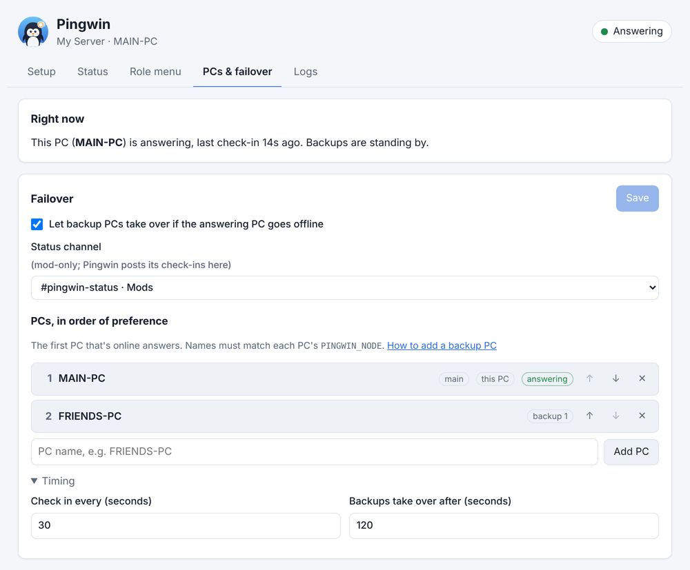

# Adding a backup PC

A backup PC keeps Pingwin running when the main PC is off or its internet is down. Every PC runs
Pingwin, but only one answers at a time. If the answering PC stops checking in for 2 minutes, the next
PC in the list takes over. When the main PC comes back, it takes the job back.

A backup helps most when it's in **a different place on a different internet connection**, like a
friend's house.

> **Trust first.** A backup PC holds your bot's token, and installs whatever is pushed to the GitHub
> repo. Only use PCs belonging to people you trust.

## The quick way (recommended)

Two codes, and the installer does the rest. It needs SyncThing running on the main PC.

**On the main PC:** open the dashboard → **PCs & failover** → **Add a backup PC** → **Create invite** →
**Copy message**, and send the message to your friend. If your settings folder isn't in SyncThing yet,
this adds it for you.

**On the backup PC:** your friend follows the message:
1. Open **PowerShell** (Windows key, type *PowerShell*).
2. Paste the line from the message and press Enter. (Or download and double-click
   [`Install-Pingwin-Backup.cmd`](../Install-Pingwin-Backup.cmd). If Windows says *Windows protected
   your PC*, click **More info → Run anyway**.)
3. Paste the invite code, and confirm the PC name.

The installer then:
- **Checks first:** shows whether Python, Git and SyncThing are already installed.
- **Asks before installing:** installs only what's missing, with winget. Windows may ask permission for Git.
- **Downloads and installs Pingwin**, and connects SyncThing to the main PC.
- **Sets Pingwin (and SyncThing, if it set it up) to start with Windows.**
- **Shows a reply code**, already copied, to send back.

**Back on the main PC:** paste the reply code into **Add a backup PC** and click **Add PC**. This shares
the settings folder with the backup and adds it to the end of the PC list. Within a minute or two, the
settings arrive and the backup's Pingwin goes on standby.

Then make sure failover is on with a status channel (steps 1 and 2 below), and [test it](#5-test-it).

The codes only contain SyncThing device and folder IDs, which aren't secret. Nothing is shared until you
add the reply code.

---

## Doing it by hand

Every PC needs two things:
- **The code**: from GitHub, so it updates itself.
- **The shared settings folder**: synced between PCs (this guide uses [SyncThing](https://syncthing.net)).
  It holds `config.toml`, `secrets.env` (the token) and `menus.json`.

This guide calls the PCs **MAIN-PC** and **FRIENDS-PC**. Use your own computers' names.

**Contents**
1. [Make a status channel](#1-make-a-status-channel)
2. [Set up the PCs & failover tab](#2-set-up-the-pcs--failover-tab)
3. [Share the settings folder](#3-share-the-settings-folder)
4. [Install Pingwin on the backup PC](#4-install-pingwin-on-the-backup-pc)
5. [Test it](#5-test-it)

---

## 1. Make a status channel

The PCs agree on who's answering through a message that Pingwin keeps up to date in a channel. Only
mods need to see it.

1. In Discord, create a text channel such as **#pingwin-status**.
2. **Edit Channel → Permissions**:
   - `@everyone`: deny **View Channel**.
   - Add the **Pingwin** role and allow **View Channel**, **Send Messages** and **Read Message History**.
   - Allow **View Channel** for your mod role(s) if you want to see it.

> If Pingwin can't see or post in the channel, it **won't appear** in the dashboard's channel list.
> That's the most common snag.

## 2. Set up the PCs & failover tab

On the main PC, open the dashboard (`scripts\open_dashboard.cmd`) and click **PCs & failover**.



### Right now
A live summary: which PC is answering, and when it last checked in. Before you turn failover on, it says
the main PC answers on its own.

### Failover settings
Work through them top to bottom, then click **Save** (top right). *Unsaved changes* appears next to
Save until you do.

1. **Let backup PCs take over if the answering PC goes offline.** Tick this. With it off, every PC
   answers on its own, which is fine for one PC but not for several.
2. **Status channel.** Pick the channel from step 1. Saving with failover on but no channel shows an
   error, so this comes first.
3. **PCs, in order of preference.** The first PC that's online answers. The rest wait in order.
   - Type the backup's name in the box and click **Add PC** (or press Enter).
   - If the PC you're on isn't listed, an **Add this PC** button appears. Click it.
   - Use **↑ ↓** to change the order, and **✕** to remove a PC.
   - The labels show each PC's job: **main** (first choice), **backup 1**, **backup 2**…, **this PC** (the
     one you're using) and **answering** (the one replying in Discord right now).

   **Names must match exactly** what each PC calls itself: the `PINGWIN_NODE` line in that PC's `.env`,
   which is normally the computer's name. Capital letters don't matter.
4. **Timing** (optional; click to open). Leave the defaults unless you have a reason:
   - **Check in every:** how often the answering PC updates the status message (30 s).
   - **Backups take over after:** how long without a check-in before a backup steps in (120 s). Shorter
     means faster takeover, but brief internet blips may cause needless switches. It must be well above
     the check-in time.

### After saving
- The toast says *Saved*. Every PC picks up the change within about a minute.
- Within ~30 s, a **🐧 Pingwin status** message appears in your status channel saying which PC is
  answering. Leave it there; Pingwin edits it to check in.
- A PC that isn't in the list can still run Pingwin, but it only steps in when every listed PC is offline.

## 3. Share the settings folder

On the main PC, in SyncThing:

1. **Add Folder** → choose your Pingwin settings folder (for example `C:\Users\you\SyncThing\Pingwin`).
   Share **only** this folder with the backup, not a parent folder holding other things.
2. **Add Remote Device** → paste the backup PC's **Device ID** (they find it under *Actions → Show ID*).
3. Edit the folder → **Sharing** → tick the backup PC → **Save**.

## 4. Install Pingwin on the backup PC

On the backup PC:

1. **Install the tools:**
   - [Python 3.11+](https://www.python.org/downloads/). In the installer, tick **Add python.exe to PATH**.
   - [Git](https://git-scm.com/download/win). The default options are fine.
   - [SyncThing](https://syncthing.net/downloads/).
2. **Accept the shared folder.** In SyncThing, accept the main PC and its *Pingwin* folder when they
   appear. Save the folder somewhere like `C:\Users\you\SyncThing\Pingwin`, and wait until it shows
   **Up to Date**.
3. **Get the code.** Open a Command Prompt where you want it (e.g. `Documents`) and run:
   ```
   git clone https://github.com/brandonbtm29/Pingwin.git
   ```
4. **Run `scripts\setup.cmd`** in the new `Pingwin` folder and answer:
   - **Settings folder:** the synced folder from step 2
   - **PC name:** exactly as it's listed on the PCs & failover tab (e.g. `FRIENDS-PC`)

   It won't ask for the token, because it's already in the synced folder.
5. **Start it with Windows.** Run `scripts\install_autostart.cmd`, then start it now with
   `scripts\run_pingwin.cmd`. The window should say:
   ```
   STANDBY on FRIENDS-PC: MAIN-PC is active
   ```
6. **Keep the PC awake.** **Settings → System → Power** → set *Sleep* to *Never* while plugged in.

The backup has its own dashboard too. Its PCs & failover tab shows the same settings, with **this PC**
next to its own name and *on standby* in the summary.

## 5. Test it

1. On the main PC, close the Pingwin window.
2. Wait about 2 minutes. The backup's window should say
   `ACTIVE on FRIENDS-PC: took over from MAIN-PC (it went quiet)`, and the message in **#pingwin-status**
   should name the backup. Try a button in your role menu: it still works.
3. Start Pingwin on the main PC again. Within about 30 seconds it takes the job back
   (`took over from FRIENDS-PC (this PC is earlier in the list)`), and the backup returns to standby.

## Good to know

- **Settings sync on their own.** Change things on any PC's dashboard. SyncThing copies the file and every
  Pingwin reloads it within a minute. Edit on one PC at a time to avoid SyncThing conflict copies.
- **Each PC has its own dashboard and log.** The Status tab and the header pill (*Answering* / *Standby*)
  show what that PC is doing.
- **Updates reach every PC** automatically from GitHub.
- **More PCs:** add more names to the list. Each one waits its turn.
- **Removing a backup:**
  - Take it off the list, stop sharing the folder with it, and run `scripts\remove_autostart.cmd` on it.
  - If that PC won't be coming back, **reset the bot token** in the Developer Portal and put the new one in `secrets.env`.

## Troubleshooting

| Problem | Fix |
|---|---|
| The status channel isn't in the list | Pingwin can't see or post there. Give the Pingwin role View Channel, Send Messages and Read Message History in that channel (step 1). |
| *Pick a status channel before turning failover on* | Choose the channel, then Save. |
| Both PCs answer (double replies) | The names don't match the list, or two PCs use the same name. Check `PINGWIN_NODE` in each PC's `.env`. |
| The backup never takes over | Check failover is ticked and saved, and the backup's window says STANDBY rather than an error. |
| The backup says the token is missing | SyncThing hasn't finished, or the backup's `.env` points at the wrong folder (`PINGWIN_DATA`). |
| Settings changes don't reach the backup | Check the SyncThing folder shows *Up to Date* on both PCs. |
| "Pingwin is already running" | Pingwin is already open in another window on that PC. Use that one. |
